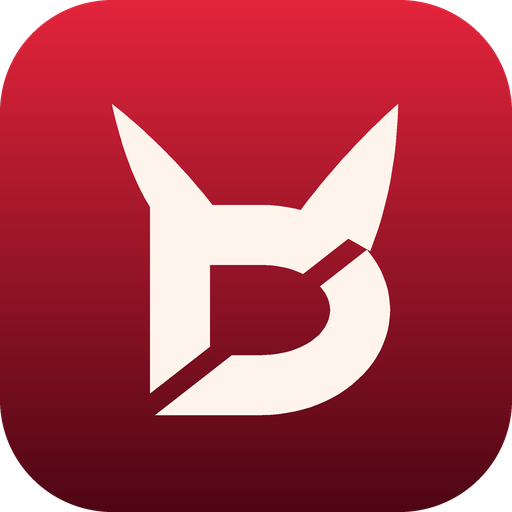

<div align="center">



# Demon Cut

**A free, open-source video editor for macOS, Windows, Linux and Android.**

[](https://github.com/DaftHD/Demon-Cut/actions/workflows/ci.yml)
[](LICENSE)

</div>

> [!NOTE]
> Demon Cut is a fork of **[Concat](https://github.com/jub0t/Concat)** by Jareer and the Concat
> contributors, under the same AGPL-3.0-or-later licence. It is not affiliated with or endorsed by the
> Concat project. [FORK.md](FORK.md) lists what changed.

## About

Demon Cut is a free, open-source video editor and a CapCut alternative. It covers what people open
CapCut for: auto-captions, text-to-speech, background removal, keyframe animation, effects and titles,
multi-track cutting, 4K export. No watermark, no account, no subscription, no upload.

Everything runs locally on a native Rust engine with a GPU compositor. The AI models for captions,
voices and cutout download once from Settings and work offline after that. Your footage never leaves
your disk.

## Highlights

- 🚫 **No watermarks. No account. No paywall.**
- 🔒 **100% local.** Nothing uploads. Works offline.
- 💬 **Auto-captions.** Local Whisper. Pick a model size, get styled captions on the timeline.
- 🗣️ **Text-to-speech and voice cloning.** Free local voices, or any voice from a few seconds of a recording.
- 🧍 **Background removal.** People, objects, or paint the mask yourself.
- 🎞️ **Keyframes.** Position, scale, rotation, opacity, volume, effect parameters. Curve editor built in.
- ✨ **170+ effects, filters, transitions and text animations.** GPU-rendered, live in the preview.
- ✂️ **Cut fast.** Split, trim, ripple, merge, freeze frame, speed. Magnetic timeline if you want it.
- 🎚️ **Multi-track, multi-timeline.** Several cuts in one project. Blend modes, crop, flips.
- 📝 **Titles.** Fonts, stroke, shadow, background plate. Presets to start from.
- 🎙️ **One-switch voice cleanup.** Denoise, enhance voice, level the loudness.
- 📤 **Export.** H.264, HEVC, AV1. Up to 4K 60, 10-bit colour.
- 🤖 **Scriptable.** JSON-RPC, gRPC and MCP API, plus a CLI (`demoncut-cli`).
- 🖥️ **macOS, Windows, Linux, Android.** 25 languages.

## Download

Builds are on the **[Releases](https://github.com/DaftHD/Demon-Cut/releases)** page. Pushing a tag
such as `v0.2.7` runs the release workflow, which builds and publishes every platform.

- **Windows** · x86_64 and ARM. A setup and an `.msi`. If SmartScreen stops an unsigned build:
  **More info** › **Run anyway**.
- **macOS** · Intel and Apple silicon. If macOS refuses to open an unsigned build:
  `xattr -dr com.apple.quarantine "/Applications/DemonCut.app"`
- **Linux** · x86_64 and ARM. `.deb`, `.rpm`, `.AppImage` and an Arch package.
- **Android** · phones and tablets.
- **iOS / iPadOS** · iPhone and iPad, sideloaded.

Demon Cut opens project folders made by Concat, and Concat opens Demon Cut's: the project format is
unchanged.

## Build from source

```bash
cd src
cargo run -p concat              # the editor window (the binary is `demoncut`)
cargo run -p concat-cli -- serve # the API on 127.0.0.1:7420 (the binary is `demoncut-cli`)
```

The crates keep their upstream names (`concat`, `concat-core`, …) so fixes from Concat merge cleanly.
[CONTRIBUTING.md](CONTRIBUTING.md) covers setup, the layout of the tree and the checks to run;
[src/README.md](src/README.md) and [ARCHITECTURE.md](ARCHITECTURE.md) go deeper.

## Licence

Demon Cut is free software under the **GNU Affero General Public License, version 3 or later**
([LICENSE](LICENSE)), with the plugin exception in [LICENSE-EXCEPTIONS.md](LICENSE-EXCEPTIONS.md),
both inherited from Concat. Third-party components are listed in
[THIRD_PARTY_NOTICES.md](THIRD_PARTY_NOTICES.md). The Demon Cut name and logo are covered by
[TRADEMARK.md](TRADEMARK.md).
